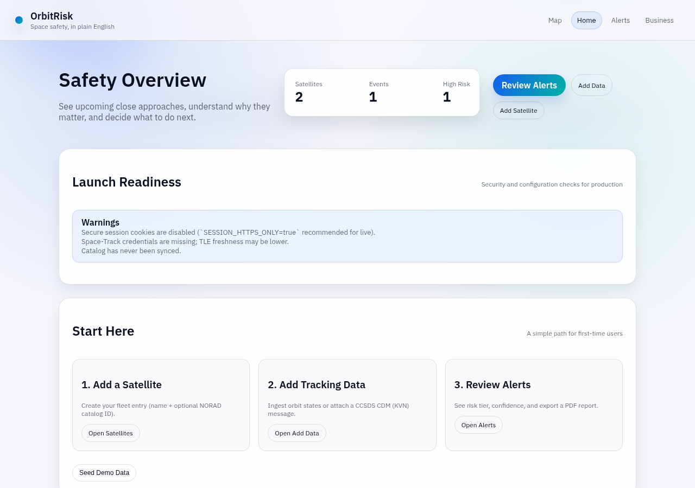

# orbtrisk-cockpit

Screening-level orbital conjunction triage, built with Python and FastAPI.

It takes orbit states (TLEs or state vectors), propagates them with SGP4, flags close approaches inside a screening volume, groups repeat alerts into one event with an update history, and gives each event a qualitative risk tier with an explicit confidence grade. An operator records decisions in an audit log, and the history can be exported as a PDF.



## What it does

- **Ingestion with provenance:** TLEs and state vectors (Space-Track GP, CelesTrak, or manual), each stored with its source and epoch.
- **Propagation:** TLE + SGP4 over a short horizon (default 14 days, `SCREENING_HORIZON_DAYS`).
- **Frames:** SGP4 TEME output is converted to GCRS with astropy. Relative geometry is computed in GCRS.
- **Screening:** close approaches inside a configurable volume (default 10 km, `SCREENING_VOLUME_KM`).
- **CCSDS CDM (KVN):** attach a CDM to an event, or post it to an inbox endpoint that creates or deduplicates the event.
- **Events:** one event with many updates (miss distance, tier, confidence, drivers over time).
- **Risk tiers:** Low / Watch / High plus a confidence grade (A-D) based on data source and TLE age.
- **Human in the loop:** decisions are written to an audit log, and the event history exports to PDF.
- **Integrations:** webhooks (`conjunction.created`, `conjunction.changed`, `screening.completed`) with optional HMAC-SHA256 signatures.
- **Hardening:** session login, trusted-host and origin checks, login rate limiting, and webhook egress limits.

## Scope limits (read before relying on it)

- **No probability of collision (Pc).** Tiers are a screening index, not a risk probability.
- **No orbit determination** and no maneuver recommendations.
- **TLE/SGP4 accuracy:** errors reach kilometers within days, so results are only good for triage.
- **Frame shortcut:** `ECI`/`GCRF`/`EME2000`/`J2000` inputs are treated as GCRS-like.
- **Offline time data:** astropy's IERS auto-download is off, so transforms outside the bundled IERS range lose accuracy.
- Personal project. Not affiliated with or endorsed by any operator or agency.

## Run locally

Python 3.11 (the version the Dockerfile and CI use).

```bash
python3.11 -m venv .venv
source .venv/bin/activate
pip install -r requirements.txt
export BUSINESS_ACCESS_CODE=dev-code      # required; gates the API and business pages
uvicorn app.main:app --reload
```

Open http://127.0.0.1:8000 for the map and http://127.0.0.1:8000/dashboard for the dashboard. `GET /healthz` needs no login. `/docs` (OpenAPI) needs a login.

Docker: `docker compose up --build`.

Optional settings are listed in `.env.example` and `app/settings.py`. Space-Track credentials (`SPACE_TRACK_USER` / `SPACE_TRACK_PASSWORD`) enable hourly GP/TLE sync. Without them it falls back to CelesTrak. Never commit real credentials.

## Tests

```bash
pip install -r requirements.txt
python -m pytest -q
```

21 tests in 6 files (`tests/`): API, auth, CDM KVN parsing, propagation, risk tiering, and settings. CI runs them on every push and pull request (`.github/workflows/ci.yml`).

## Example: ingest a state vector

```bash
curl -X POST http://127.0.0.1:8000/ingest/orbit-state \
  -H 'Content-Type: application/json' \
  -d '{"epoch":"2026-02-04T00:00:00Z","state_vector":[7000,0,0,0,7.5,0],
       "confidence":0.7,"source":{"name":"public-tle","type":"public"},
       "satellite":{"name":"Alpha","orbit_regime":"LEO","status":"active"}}'
```

Post a CDM to the inbox (it creates or deduplicates the event):

```bash
curl -X POST http://127.0.0.1:8000/cdm/inbox -H 'Content-Type: text/plain' --data-binary @cdm_message.kvn
```

## Layout

```
app/services/   propagation, frames, screening, conjunction, risk, cdm_kvn, ingestion, webhooks, audit
app/api/routes/ REST endpoints
app/templates/  dashboard and viewer (Jinja2)
tests/          pytest suite
```

## License

MIT (see `LICENSE`). Third-party components are listed in `THIRD_PARTY_NOTICES.md` (Chart.js, MIT).
